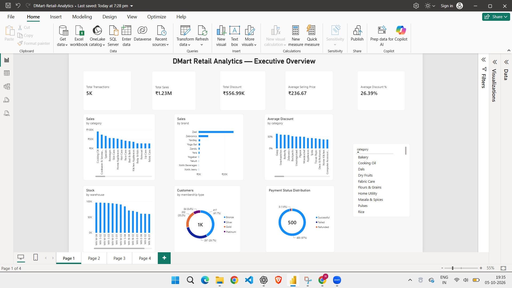
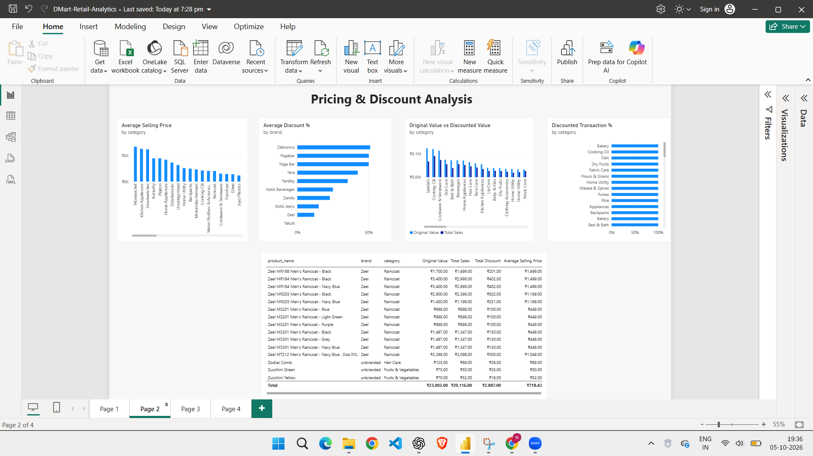
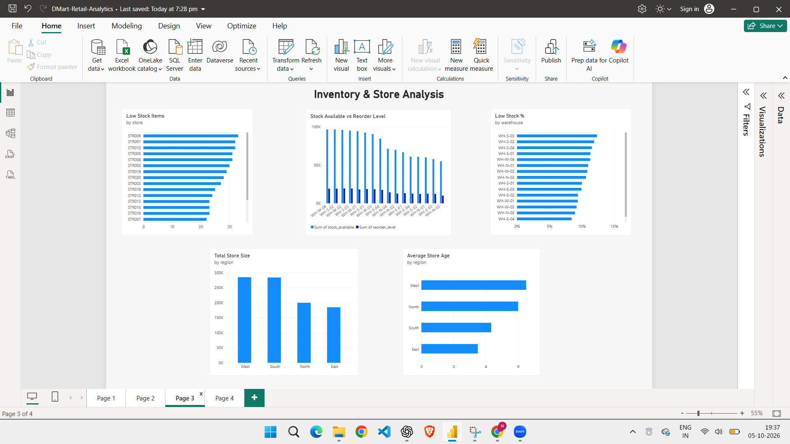
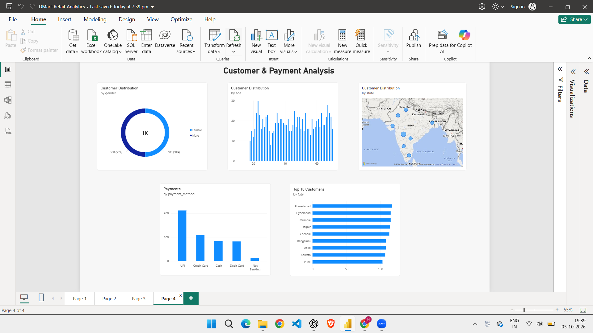

# 📊 DMart Retail Analytics — Power BI Dashboard

## Project Overview

This Power BI report is part of the DMart Retail Analytics portfolio project. It explores product pricing, discounts, and available retail-related datasets through interactive dashboards.

The report demonstrates data visualization, DAX measures, data modelling, and dashboard design.

**Data limitation:** The sales/pricing dataset contains product-level records rather than verified sales transactions. Price-based totals are sums of available price fields and must not be interpreted as confirmed revenue or actual units sold.

## Dashboard Pages

### 1. Executive Overview

Provides a high-level summary of the available pricing records and selected analytical indicators.

### 2. Pricing and Discount Analysis

Explores original prices, discounted prices, discount percentages, and comparisons across available product categories and brands.

### 3. Inventory and Store Analysis

Examines the available inventory and store information. Comparisons are subject to the matching keys and relationships supported by the datasets.

### 4. Customer and Payment Analysis

Presents available customer and payment-related information while accounting for the limitations of the supplied datasets and their relationships.

## Tools and Techniques

- **Power BI Desktop** — report creation and visualization
- **Power Query / data preparation** — data inspection and preparation where applicable
- **DAX** — measures and analytical calculations
- **Data modelling** — relationship inspection and validation
- **Interactive visuals** — KPI cards, charts, and slicers

## Key Analytical Areas

- Product pricing comparisons
- Discount patterns
- Category and brand comparisons
- Available inventory and store information
- Available customer and payment attributes
- Data quality and metric interpretation

## Important Notes

- The source sales/pricing dataset contains 5,189 records.
- The available fields do not establish verified transaction-level revenue or actual units sold.
- Record counts may differ across tools when cleaning or filtering is applied.
- Cross-table analysis is limited to valid relationships and matching keys.
- Dashboard metrics should be interpreted according to the available data rather than as verified company-wide business results.

## Project Files

- [Power BI Report](DMart-Retail-Analytics.pbix)
- [Executive Overview](01_Executive_Overview.png)
- [Pricing and Discount Analysis](02_Pricing_Discount_Analysis.png)
- [Inventory and Store Analysis](03_Inventory_Store_Analysis.png)
- [Customer and Payment Analysis](04_Customer_Payment_Analysis.png)
- [Main Project README](../README.md)

---

*Created as part of a Data Analytics portfolio project using retail-inspired data.*
