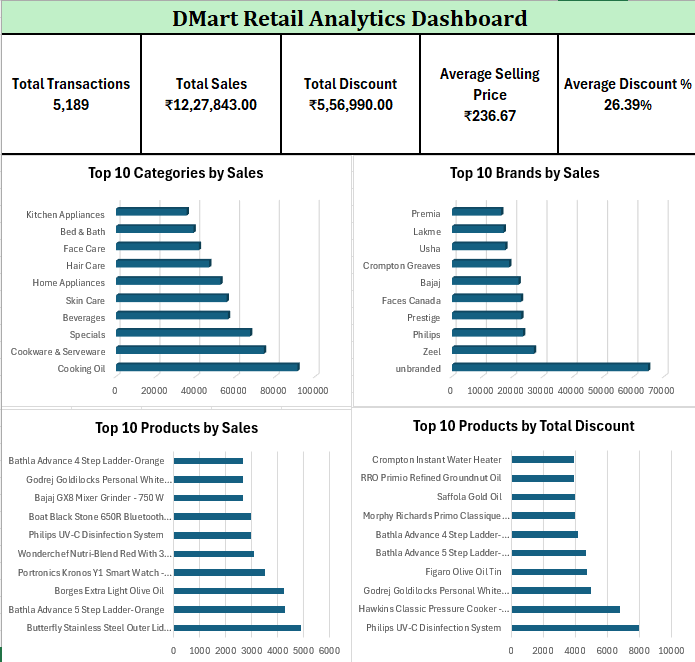

# 🛒 DMart Retail Analytics | End-to-End Data Analytics Project

## 📌 Project Overview

This project analyzes DMart-inspired retail datasets to explore product pricing, discount patterns, category and brand comparisons, inventory levels, customer demographics, store characteristics, and payment outcomes.

The project demonstrates an end-to-end Data Analyst workflow using **Microsoft Excel, PostgreSQL/SQL, Python (Pandas), and Power BI**. It includes data exploration, data quality checks, analytical queries, dashboard development, and business-oriented interpretation.

**Important data limitation:** The sales/pricing dataset contains product-level records rather than verified sales transactions. Price-based totals in this project are sums of the available price fields and should not be interpreted as confirmed business revenue, completed orders, or units sold.

## 🎯 Project Objectives

- Analyze product pricing and discounted prices.
- Compare discounts across product categories and brands.
- Identify categories and products with higher recorded price totals.
- Examine available inventory and store information.
- Explore customer and payment datasets within the limits of their available fields.
- Perform data quality checks for missing values, duplicate records, and invalid prices.
- Develop interactive Power BI dashboards and an Excel dashboard.
- Demonstrate practical SQL, Python/Pandas, Excel, and Power BI skills.

## 🗂️ Dataset Overview

The project uses DMart-inspired retail datasets, including the following tables or datasets:

| Dataset | Purpose |
|---|---|
| `Sales_Transactions` | Product names, brands, original prices, discounted prices, quantity information, and categories |
| `Customers` | Available customer-related attributes |
| `Inventories` | Available inventory and store-related records |
| `Payments` | Available payment-related records |
| `Stores` | Store attributes and identifiers |
| `Suppliers` | Supplier-related information |

The sales/pricing dataset contains **5,189 source records**.

### Data Limitations and Metric Interpretation

- The source sales/pricing dataset contains 5,189 records.
- The available fields do not establish verified sales dates, actual units sold, or transaction-level revenue.
- The `Quantity` field contains package or unit descriptions in the available data and should not automatically be treated as the number of units sold.
- Data-cleaning steps can cause the number of records analyzed in Python to differ from the source record count.
- The customer, inventory, payment, store, and sales datasets have limited matching keys. Cross-table relationships and comparisons are therefore restricted to supported fields and valid relationships.
- Metrics labelled **Total Sales** in the dashboards represent sums of available discounted-price values, not confirmed business revenue.
- Price totals and averages are descriptive measures of the available records, not verified financial performance.

## 🛠️ Tools and Technologies

| Tool | Application |
|---|---|
| Microsoft Excel | Data cleaning, formulas, PivotTables, analysis, and dashboard creation |
| PostgreSQL | Data exploration, aggregation, filtering, joins, subqueries, and analytical SQL |
| Python | Data analysis and data cleaning using Pandas |
| Power BI | Data modelling, DAX measures, interactive visuals, and dashboard development |
| GitHub | Version control, documentation, and portfolio presentation |

## 📊 Project Components

### 1. Microsoft Excel Analysis

**File:** [`Excel/DMart_Retail_Analytics_Excel.xlsx`](Excel/DMart_Retail_Analytics_Excel.xlsx)

The Excel workbook includes:

- `Raw_Data` — source data.
- `Data_Cleaning` — data quality checks and preparation.
- `Analysis` — formula-based analysis.
- `Pivot_Analysis` — PivotTables and comparisons.
- `Dashboard` — consolidated visual summary.

**Key activities:**
- Reviewed product prices and discounts.
- Used formulas to calculate relevant metrics.
- Analyzed categories and brands using PivotTables.
- Created a dashboard to summarize the available data.

**Excel dashboard preview:**

### 2. SQL Analysis — PostgreSQL

**File:** [`SQL/DMart_Retail_Analytics.sql`](SQL/DMart_Retail_Analytics.sql)

The SQL script contains 50 analytical queries covering data exploration, aggregation, pricing, discounts, and data quality.

**SQL concepts demonstrated:**
- `SELECT`, `WHERE`, `ORDER BY`, and `DISTINCT`
- Aggregate functions: `SUM`, `AVG`, `MIN`, and `MAX`
- `GROUP BY` and `HAVING`
- `CASE WHEN` conditional logic
- Joins and subqueries
- Common Table Expressions (CTEs)
- Window functions and ranking
- Discount calculations and percentage analysis
- Data quality checks

**Analytical focus:**
- Category-level price comparisons.
- Brand-level comparisons.
- Discount patterns.
- Product pricing analysis.
- Record-level data quality exploration.

SQL results should be interpreted in the context of the available product-level data. Price-based totals do not establish actual revenue.

### 3. Python Analysis — Pandas

**File:** [`Python/DMart_Retail_Analytics_Python.ipynb`](Python/DMart_Retail_Analytics_Python.ipynb)

The Python notebook demonstrates a structured data analysis workflow using Pandas.

**Key activities:**
- Loading and inspecting the dataset
